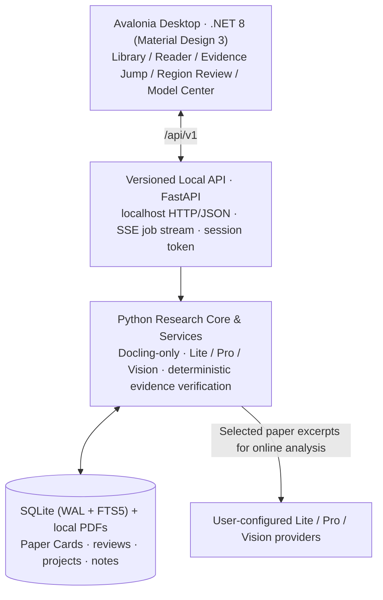

<p align="center">
  
</p>

<h1 align="center">Social Science Research IDE</h1>

<p align="center">
  <strong>From papers to auditable research understanding.</strong><br />
  从 PDF 到可追溯的主张、证据与方法学审读，而不只是另一份 AI 摘要。
</p>

<p align="center">
  <a href="https://github.com/daseinzc-509/social-science-research-ide/actions/workflows/ci.yml"></a>
  <a href="https://github.com/daseinzc-509/social-science-research-ide/releases"></a>
  
  
  
  
  
</p>

<p align="center">
  <a href="#-为什么做-sra">为什么做 SRA</a> ·
  <a href="#-核心能力">核心能力</a> ·
  <a href="#-下载与使用">下载与使用</a> ·
  <a href="#-系统架构">系统架构</a> ·
  <a href="#-隐私与安全">隐私与安全</a> ·
  <a href="#-开发与测试">开发与测试</a> ·
  <a href="CHANGELOG.md">更新日志</a> ·
  <a href="#-license--授权">License</a>
</p>

> [!IMPORTANT]
> **当前版本：`v0.2.2`（单篇论文精读桌面稳定版）。** Windows x64 与 macOS Apple Silicon 均通过 GitHub Actions 原生构建、冻结后端自检与安全门禁，开箱即用无需单独启动 Python 终端。
> - **签名提示**：Windows 安装器暂未购买商业 Authenticode 证书；macOS Apple Silicon（ARM64，macOS 14+）包采用本地 ad-hoc 签名，**尚未经过 Apple Developer ID 公证**，首次打开可能需要在系统「隐私与安全性」中手动放行。
> - **平台边界**：**macOS Intel（x86_64）与 Linux 暂不提供安装包。**

---

## ✨ 为什么做 SRA

研究阅读真正困难的地方，往往不在于得到一段摘要，而在于回答：**作者究竟主张了什么？原文证据在哪里？结论在什么条件下成立？AI 的判断又根据什么作出？**

SRA（Social Science Research IDE）探索一种 **local-first、evidence-first** 的研究工作流：

- **保留可追溯来源**：让论文主张与 PDF 页码、段落、原文片段建立明确关联，并可一键跳回原 PDF 高亮位置。
- **区分三种声音**：作者陈述（`AUTHOR`）、AI 方法学审读（`AI REVIEW`）、研究者笔记（`MY NOTE`）在数据与视觉上严格分离。
- **分离两种“支持”**：找到来源（traceability）不等于该来源在语义上证明结论（semantic support）。
- **为继续研究而组织信息**：先形成可审计的单篇理解，再逐步扩展到多文献比较与研究写作。

**定位：个人研究阅读环境，而非自动生成可直接提交的论文综述。**

## 🔎 核心能力

| 模块 | 当前能力（`v0.2.2`） |
| --- | --- |
| **PDF 理解** | 纯 Docling 版式解析与 OCR（已彻底移除 PyMuPDF 依赖）；保留 page / bbox / `SourceBlock` 与合并单元格表格结构。 |
| **结构化研究事实** | Lite 提取题名、作者、研究问题与基础事实；元数据按来源与版式规则确定性核验，支持手动修订且重跑不覆盖。 |
| **独立方法学审读** | Pro 独立回源整篇文档，依据研究类型（实验 / 观察性定量 / 质性 / 理论 / 混合方法）审查研究设计、限定条件与风险。 |
| **Claim → PDF 跳页高亮** | 点击精读或证据卡片中任意原文证据的「定位 PDF 原文 →」，直跳对应 PDF 页并以琥珀色荧光框高亮对应 `SourceBlock`。 |
| **局部 OCR 与 v5 独立复评** | 三子分页局部复核窗（框选校订 / 版本历史 / 独立 Pro 复评）；修订可追溯、可撤回，外发前必须本地预检并显式勾选授权。 |
| **MD3 桌面工作台** | Google Material Design 3 明暗双主题、全窗口拖放导入单篇/批量/文件夹 PDF、高频快捷键（`Ctrl+F` / `Ctrl+/` / `Ctrl+O` / `Esc`）、统一模型与代理配置中心。 |
| **本地引擎与全文检索** | SQLite WAL 并发加固 + FTS5 中英双语全文检索 + SSE 实时任务流（支持取消与轮询降级）+ 后端防孤儿进程联杀；支持导出 JSON / 精读 Markdown / 解析文本 / Zotero BibTeX。 |

<details>
<summary><strong>学术审读具体区分了什么？</strong></summary>

| 层级 | 典型问题 | 说明 |
| --- | --- | --- |
| **Source location** | 这条论断是否准确指向 PDF 页与原文？ | `VerificationStatus` 只表示可定位性，不等于已证明。 |
| **Semantic relationship** | 原文支持、部分支持、限定还是反驳该说法？ | `SemanticSupportStatus` 属于模型辅助判断，需保留人工核查可能性。 |
| **Study profile** | 这是实验、观察性定量、质性、理论还是混合方法研究？ | 研究类型影响审读维度，而不是套用同一模板。 |
| **Method review** | 测量、识别、抽样、解释与外推有什么限制？ | 作者陈述与 AI 审读明确分开。 |

</details>

## 💻 下载与使用

**[GitHub Releases](https://github.com/daseinzc-509/social-science-research-ide/releases)** · **[CHANGELOG](CHANGELOG.md)** · **[构建与测试状态](https://github.com/daseinzc-509/social-science-research-ide/actions)**

| 平台 | 发布格式 | 说明 |
| --- | --- | --- |
| **Windows x64** | `SRA-Desktop-Setup-win-x64-*.exe`（推荐）、便携 `.zip` | 一体化捆绑桌面端与冻结 Python/Docling 后端；单用户目录安装，卸载默认保留个人研究数据。 |
| **macOS Apple Silicon** | `SRA-osx-arm64-*.dmg`（推荐）、`.app` `.zip` | ARM64，macOS 14+；一体化捆绑包，使用本地 ad-hoc 签名，**尚未经过 Apple 公证**。 |
| macOS Intel / Linux | — | **暂不提供安装包**，不在当前发布矩阵。 |

**捆绑安装版**在启动桌面应用时会自动拉起受 256-bit 进程令牌保护的本地 Python 后端，无须手动打开终端，关闭窗口时同步回收后端进程；首次运行前在「设置 → 打开模型配置中心」填写自己的 Lite / Pro / Vision API 配置，并在「Docling / 增强」中按需管理离线模型权重。

### 源码开发快速开始（Windows）

准备 Python 3.12、Conda，以及可构建 `net8.0` / Avalonia 12 的 .NET SDK（推荐 .NET 10 SDK）。在项目根目录运行：

```powershell
conda create -p .conda-env -c conda-forge python=3.12 pip
conda run -p .conda-env python -m pip install -e ".[api,dev]"
```

复制 `.env.example` 为**本地、不提交**的 `.env`（或直接在桌面端「模型配置中心」可视化配置）：

```powershell
Copy-Item .env.example .env
```

在两个终端分别启动：

```powershell
# 终端 1：本地 API（开发模式）
conda run --no-capture-output -p .conda-env sra api
```

```powershell
# 终端 2：Avalonia 桌面应用
dotnet run --project .\desktop\SRA.Desktop\SRA.Desktop.csproj -c Release
```

> 源码开发模式的本地 API 不等同于已加会话令牌保护的**捆绑版 API**；请仅绑定回环地址 `127.0.0.1`，不要公开到局域网或互联网。

### 常用 CLI

```powershell
conda run -p .conda-env sra import-pdf "D:\papers\example.pdf"
conda run -p .conda-env sra import-pdf-dir "D:\papers" --json
conda run -p .conda-env sra list
conda run --no-capture-output -p .conda-env sra analyze PAPER_ID --run
conda run -p .conda-env sra export-card PAPER_ID --output paper-card.json
conda run -p .conda-env sra doctor --deep
```

## 🧭 系统架构

**Avalonia 负责交互；FastAPI 提供本地版本化边界；Python 承担研究理解；SQLite 保存研究状态。** 桌面界面不直接读写数据库，也不把证据校验逻辑复制到 C#。



单篇论文处理流程：

```text
PDF
 └─ Docling Parser / OCR → SourceBlock + page/bbox provenance
     └─ Evidence ledger
         ├─ Lite → metadata + author-stated claims
         ├─ Metadata provenance / deterministic checks
         └─ Research-type router → Pro independent retrieval + method review
              └─ PaperCard / ClaimAudit / SemanticSupport
                   ├─ MD3 Desktop views + Claim → PDF page highlight jump
                   └─ Deterministic deep-reading Markdown
```

### 设计约束

1. **Evidence First** — 所有可定位的原文证据都保留页码、原文块坐标与出处。
2. **Traceability ≠ Entailment** — 一条证据被定位，不自动表示主张已获证明。
3. **Source separation** — 作者主张、AI 评价、人工校订与个人笔记保持独立来源身份。
4. **Deterministic verification** — 页码、证据 ID、缓存、Evidence Matrix 与结构化校验优先交由代码处理。
5. **Human researcher in control** — 所有外发模型分析与计费操作遵循显式授权与 fail-closed 原则。

### 主要目录

```text
.
├── desktop/SRA.Desktop/       # Avalonia MD3 UI / desktop lifecycle / Windows Job Object
├── src/sociology_research/    # Python models, parser, analysis modules, repository (WAL + FTS5)
│   ├── api/                   # Local FastAPI routes, SSE events, typed schemas
│   └── services/              # Application services (jobs, projects, model center, region review)
├── scripts/                   # Build, frozen self-test probe, pruning, safety & size audit tools
├── installer/                 # Windows Inno Setup / macOS .app packaging
├── .github/workflows/         # Dual-platform CI and release pipeline
├── tests/                     # 400 automated regression & contract tests
├── docs/                      # Distribution, security, install & development docs
├── CHANGELOG.md               # Version release notes
├── PROJECT_DESIGN.md          # Long-term product and research principles
└── README.md
```

## 🔐 隐私与安全

**本地保存**不等于**完全离线分析**。SRA 默认将论文、SQLite 数据库与模型配置留在当前用户的私有目录；当你主动启动在线 Lite / Pro / Vision 分析或独立复评时，**选中的论文文本片段（或单张裁剪图）会发送给你所配置的模型服务商**。

| 类别 | Windows 捆绑版 | macOS Apple Silicon 捆绑版 |
| --- | --- | --- |
| 私人 PDF / 数据库 | `%LOCALAPPDATA%\SRA\data` | `~/Library/Application Support/SRA/data` |
| API Key | Windows DPAPI 当前用户加密 | macOS Keychain |
| 后端通信 | `127.0.0.1`、随机端口、256-bit 进程级会话令牌 | 同左 |
| 公开发行包 | 不包含任何 `.env`、PDF、SQLite | 同左 |

- 构建流水线对源码、构建目录和压缩包强制执行敏感文件扫描；**不要直接压缩开发目录发给别人**。
- 更新检测仅请求公开 GitHub Releases 信息并提示用户手动安装，绝不静默下载执行。
- 卸载默认保留个人研究数据；交互式卸载支持显式二次确认后清除 SRA 专属目录。

详细说明：[跨平台分发](docs/CROSS_PLATFORM_DISTRIBUTION.md) · [安全与私人数据](docs/SECURE_DISTRIBUTION.md) · [安装、更新与卸载](docs/INSTALL_UPDATE_UNINSTALL.md)

## 🧪 开发与测试

日常源码开发请先阅读 [**源码开发指南**](docs/DEVELOPMENT.md)。

```powershell
# 全量 Python 核心、API、打包策略与桌面契约测试（400+ cases）
conda run -p .conda-env python -m pytest -q tests

# Release 编译桌面端（要求 0 警告 0 错误）
dotnet build .\desktop\SRA.Desktop\SRA.Desktop.csproj -c Release

# 源码隐私安全门禁
conda run -p .conda-env python scripts\check_release_safety.py source .
```

- [CI：双端回归与编译](https://github.com/daseinzc-509/social-science-research-ide/actions/workflows/ci.yml)
- [Release：Windows + macOS 联合打包](https://github.com/daseinzc-509/social-science-research-ide/actions/workflows/release-desktop.yml)
- [提 Issue / 报告问题](https://github.com/daseinzc-509/social-science-research-ide/issues)

## 🗺️ 路线图

| 方向 | 状态 |
| --- | --- |
| 论文导入、Docling provenance、Lite / Pro 审读、精读报告与导出 | **已实现（v0.2.2）** |
| MD3 桌面工作台、全窗口拖放、快捷键、统一模型配置中心、SSE 任务流 | **已实现（v0.2.2）** |
| Claim → 原文证据直跳 PDF 高亮、局部 OCR 校订与 v5 独立 Pro 复评 | **已实现（v0.2.2）** |
| Windows + macOS Apple Silicon 一体化打包、离线裁剪与自检流水线 | **已实现（v0.2.2，macOS 暂为自签名）** |
| 研究项目与跨论文 Evidence Matrix（后端 API 已就绪，接入桌面端前端） | **下一阶段（v0.3.0）** |
| 个人阅读笔记（`MY NOTE`）编辑、Claim 单条人工审定状态与 PDF 缩放 | **下一阶段（v0.3.0）** |
| Eval Harness 评测基准、显式 Schema Migration、Book Understanding 与综述写作 | **中长期路线** |

> **范围边界：** `SemanticSupportStatus` 属于可复核的模型辅助判断，而不是因果识别、统计显著性或研究结论的数学证明。研究者应对重要引文、解释与外部模型处理政策独立复核。

## 📚 项目文档

- [`CHANGELOG.md`](CHANGELOG.md) — 版本发布与变更记录。
- [`PROJECT_DESIGN.md`](PROJECT_DESIGN.md) — 产品定位、原则与长期路线图。
- [`docs/CROSS_PLATFORM_DISTRIBUTION.md`](docs/CROSS_PLATFORM_DISTRIBUTION.md) — Windows / macOS 打包架构、签名边界与发布流程。
- [`docs/SECURE_DISTRIBUTION.md`](docs/SECURE_DISTRIBUTION.md) — API Key、PDF、数据隔离和安全门禁。
- [`docs/INSTALL_UPDATE_UNINSTALL.md`](docs/INSTALL_UPDATE_UNINSTALL.md) — 安装、更新、卸载与个人数据保护。
- [`docs/CI_AND_RELEASE.md`](docs/CI_AND_RELEASE.md) — 双端 CI 与 Release 自动化说明。
- [`docs/REPOSITORY_HYGIENE.md`](docs/REPOSITORY_HYGIENE.md) — 仓库卫生与目录清理说明。

## 📄 License / 授权

Original source code that its contributors have the right to license is
released under **[GNU AGPL-3.0-only](LICENSE)**. The license allows commercial
use but requires covered downstream modifications to honor its copyleft
obligations. It **does not** prohibit all commercial activity.

Project identity and artwork are discussed in [TRADEMARKS.md](TRADEMARKS.md).
Contributions: [CONTRIBUTING.md](CONTRIBUTING.md). Detailed notes:
[docs/LICENSING.md](docs/LICENSING.md).

**AI-assisted development.** SRA is maintained by a person and has been
built with significant AI assistance. The maintainer leads product decisions,
review and tests. The project makes no blanket claim of exclusive copyright
in purely AI-generated or third-party material; see the licensing notes.

---

<p align="center">
  <strong>Evidence before fluency. Researcher before automation.</strong><br />
  <sub>Social Science Research IDE · 本地优先的可审计学术理解工作台</sub>
</p>
