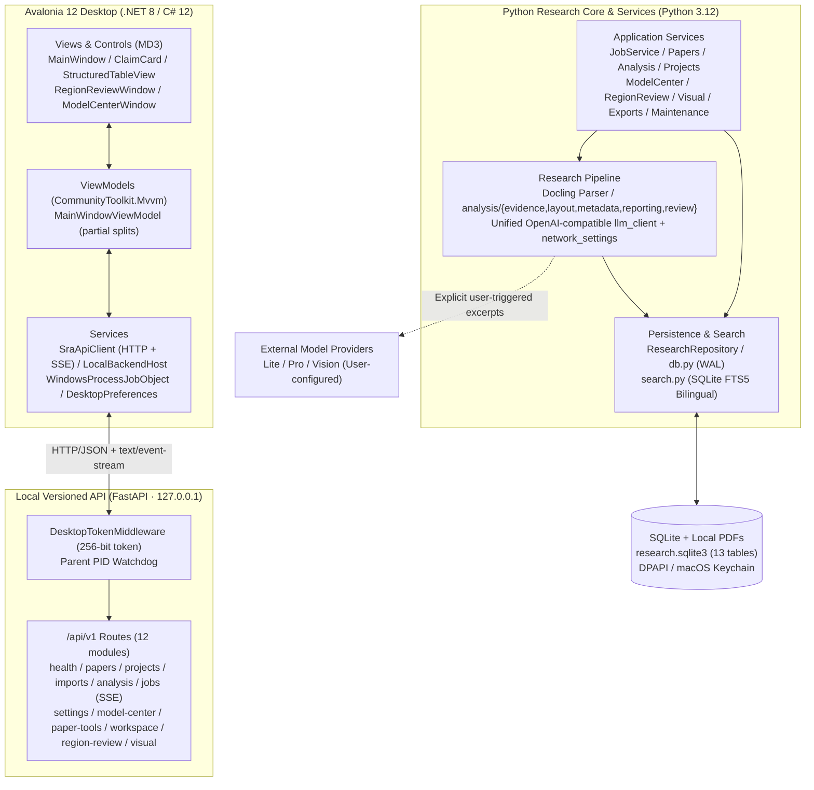
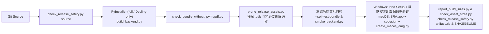

# 系统技术架构文档（Architecture Guide）

> 适用版本：`v0.2.2+`（向 `v0.3.0` 跨文献研究工作台演进）
>
> 本文档说明 Social Science Research IDE（SRA）的前后端分层边界、核心数据流、SQLite 存储结构、本地 `/api/v1` 契约、Avalonia 12 MD3 桌面端实现与双端打包架构。产品理念与中长期路线见 [PROJECT_DESIGN.md](../PROJECT_DESIGN.md)，AI 协作规范与契约红线见 [AGENTS.md](../AGENTS.md)。

---

## 1. 总体分层架构

SRA 严格遵循 **Presentation Boundary（表现层边界）**：桌面端只负责渲染与交互，绝不直连 SQLite 或嵌入 Docling；Python 引擎通过 `127.0.0.1` 版本化 HTTP API 与 SSE 向桌面端提供全部能力。

---

## 2. Python 后端模块映射

### 2.1 应用服务层（`src/sociology_research/services/`）
由 `services/application.py` 中的 `create_application_services(data_dir, repository)` 统一装配并挂载至 `app.state.services`：

| 模块 | 核心职责 |
| --- | --- |
| `jobs.py` | 后台长任务调度中心（`JobService`）：区分重任务车道（`max_heavy_workers` 限流，防止并发 Docling/LLM 压垮本机）、支持检查点取消（`JobCancelled`）、终态任务数量上限回收（不驱逐活跃任务）、SSE 订阅广播。 |
| `papers.py` | PDF 导入（单篇/批量去重与诚实逐文件结果统计）、重解析、删除、元数据修订、全文检索与详情组装。 |
| `analysis.py` | 单篇与批量论文 Lite/Pro 分析编排、费用/范围预检、参考文献提取。 |
| `projects.py` | 研究项目 CRUD、论文归属与阅读状态管理、以及**零 LLM 调用的确定性 Evidence Matrix** 构建（复用 `analysis/reporting.py` 提取结构化比较矩阵）。 |
| `model_center.py` | 统一管理 Lite / Pro / Vision 命名配置、独立下载/AI 代理、托管 Docling 权重下载与独立子进程离线验证、公式/图片增强开关。 |
| `region_review_service.py` + `region_review.py` + `region_review_versioning.py` + `region_review_reanalysis.py` | PDF 栅格渲染、区域 OCR/人工抄录草稿、多版本人工修订历史与源块指纹失效检测、以及 v5 独立 Pro 复评（含本地快照指纹预检、外发正文预览、显式双重确认与独立快照保存）。 |
| `visual.py` | 表格/图片区域本地裁剪预览（不收费）与经研究者显式确认后的单张图片 Vision API 分析。 |
| `exports.py` & `maintenance.py` | JSON / 精读 Markdown / 解析纯文本 / Zotero BibTeX 导出；Repository Doctor（快速与深度哈希校验）与旧 prompt 缓存清理。 |

### 2.2 研究核心与基础设施（`src/sociology_research/`）
- **`parser.py`**：纯 Docling PDF 解析器（已移除 PyMuPDF），输出带 `page_number`、`bbox`、`table_rows`、`table_cells`（合并单元格坐标）与 `figure_regions` 的 `ParsedDocument`。
- **`analyzer.py` + `analysis/`**：
  - `analysis/layout.py`：版式与前后页结构识别；
  - `analysis/metadata.py`：基于首页版式与确定性规则的书目元数据核验；
  - `analysis/evidence.py`：证据账本与确定性溯源核对；
  - `analysis/review.py`：按 `StudyType` 路由的 Pro 独立回源与方法学审读；
  - `analysis/reporting.py`：由 `PaperCard` 确定性重排连续精读报告，零额外模型调用。
- **`llm_client.py` & `network_settings.py`**：统一的多模态 / 文本 OpenAI-compatible HTTP 客户端与独立代理配置（支持系统代理、直连、自定义 HTTP/Mixed 代理）。
- **`user_storage.py` & `storage_inventory.py`**：跨平台用户私有目录定位（Windows DPAPI 加密 / macOS Keychain）与存储空间统计。

---

## 3. SQLite 存储与 FTS5 检索引擎

### 3.1 连接与并发加固（`db.py`）
所有 SQLite 访问统一经由 `open_sqlite_connection()` / `sqlite_connection()`：
- `PRAGMA journal_mode = WAL`（支持读写并发，杜绝常规 `database is locked`）；
- `PRAGMA foreign_keys = ON`（强制外键级联一致性）；
- `PRAGMA busy_timeout = 15000`（15 秒锁等待缓冲）；
- 关键并发写事务（如复评提交）使用 `BEGIN IMMEDIATE` 避免死锁升级。

### 3.2 数据库表全景（共 16 张表）

| 表名 | 所属模块 | 职责与核心关系 |
| --- | --- | --- |
| `papers` | `repository.py` | 论文主记录（`sha256` 唯一去重、页数、解析状态、`parser_version`）。 |
| `source_blocks` | `repository.py` | Docling 提取的原始文本块/公式/表格（含 `bbox_json`、`table_rows_json`、`table_cells_json`），级联绑定 `papers`。 |
| `figure_regions` | `repository.py` | Docling 定位的图片/统计图区域坐标与题注。 |
| `paper_cards` | `repository.py` | 当前论文的结构化 `PaperCard` JSON（含 `basic_facts`、`analysis`、`study_profile`、`claim_audits`）。 |
| `paper_metadata_overrides` | `repository.py` | 研究者手动修订的书目元数据（重跑解析或分析时绝不被覆盖）。 |
| `user_notes` | `repository.py` | 研究者个人阅读笔记（`USER_NOTE`，含可选标题与关联 PDF 页码，重跑分析绝不覆盖）。 |
| `claim_reviews` | `repository.py` | 单条 Claim 四态人工审定与修正记录（`HUMAN_REVIEWED`，`UNIQUE(paper_id, claim_id)`，物理隔离于 `paper_cards`，重跑分析绝不覆盖）。 |
| `model_runs` | `repository.py` | 按 `(paper_id, stage, model, prompt_version, input_sha256)` 索引的模型响应缓存。 |
| `reference_entries` | `repository.py` | 结构化参考文献条目。 |
| `citation_mentions` | `repository.py` | 正文引文提及记录。 |
| `research_projects` | `repository.py` | 研究项目实体（名称大小写不敏感唯一、研究问题、说明）。 |
| `project_papers` | `repository.py` | 项目与论文的多对多关联（阅读状态 `reading_status`、项目备注、排序位）。 |
| `project_notes` | `repository.py` | 专题级跨文献综合研究笔记（`USER_NOTE`，随专题 Markdown 证据矩阵一并导出）。 |
| `search_fts` | `search.py` | **SQLite FTS5 虚拟表**：中英双语混合分词（中文 2-gram + 英文词干/前缀）索引论文正文、PaperCard（含证据引文）、个人笔记（`USER_NOTE`）、人工局部复核与 Claim 人工审定（`HUMAN_REVIEWED`）；支持按专题 `project_id` 与 `source_kind` 过滤。 |
| `region_reviews` | `services/region_review.py` | 局部 OCR / 人工校订多版本审计记录（含 `revision_no`、源块内容指纹与撤回时间）。 |
| `review_reanalyses` | `services/region_review_reanalysis.py` | v5 独立 Pro 复评快照（与原 `paper_cards` 隔离对照，记录 `original_card_sha256`）。 |

---

## 4. 本地版本化 API 契约（`/api/v1`）

组成根位于 `src/sociology_research/api/app.py`，统一映射域异常：`KeyError` / `FileNotFoundError` → `404`、`ValueError` → `400`、`PaperAnalysisError` → `422`、`ModelRequestError` → `502`。

| 路由模块 | 前缀与关键端点 | 说明 |
| --- | --- | --- |
| `health` | `GET /api/v1/health` | 后端就绪探针。 |
| `papers` | `GET /papers`, `GET /papers/search`, `GET/DELETE /papers/{id}`, `GET /papers/{id}/pdf`, `GET /papers/{id}/reading-report`, `POST /papers/{id}/reparse` | 文献库管理、FTS5 双语检索、原文流与精读报告。 |
| `projects` | `GET/POST /projects`, `GET/PUT/DELETE /projects/{id}`, `POST/DELETE /projects/{id}/papers/{paper_id}`, `GET/POST/PUT/DELETE /projects/{id}/notes`, `GET /projects/{id}/evidence-matrix{,.csv,.md}` | 专题聚合、专题研究笔记、零 LLM 确定性 Evidence Matrix 及 Excel CSV / Markdown 导出。 |
| `imports` | `POST /import`, `POST /import-batch` | 异步 PDF 导入（返回 `202 JobAccepted`）。 |
| `analysis` | `POST /{paper_id}/analysis/preview`, `POST /{paper_id}/analyze` | 费用/截断预检与异步 Lite/Pro 分析。 |
| `jobs` | `GET /jobs`, `GET /jobs/{id}`, **`GET /jobs/{id}/events`（SSE）**, `POST /jobs/{id}/cancel` | 任务状态查询、Server-Sent Events 实时进度流与安全取消。 |
| `paper_tools` | `POST/DELETE /{id}/metadata`, `GET/POST/PUT/DELETE /{id}/notes`, `GET/PUT/DELETE /{id}/claim-reviews`, `POST /{id}/references/extract`, `GET /{id}/{card.json,text.txt,references.json,references.bib}` | 元数据修订、个人笔记、Claim 单条人工审定、参考文献提取与多格式导出。 |
| `region_review` | `/pages/{n}.png`, `/pages/{n}/blocks`, `/pages/{n}/preview`, `/confirm`, `/reviews`, `/reviews/{id}/{revise,revoke}`, `/packet`, `/reanalysis/{preview,run,reports}` | 原文对照、局部 OCR、版本修订与 v5 独立 Pro 复评。 |
| `visual` | `/settings/visual`, `/figures/{id}/preview`, `/figures/{id}/analyze` | 裁剪图本地预览与显式授权后的 Vision 图片分析。 |
| `model_center` | `/model-center`, `/profiles`, `/activate`, `/network`, `/enhancements`, `/models/{mode,download,verify}` | 统一模型配置、代理与 Docling 权重管理。 |
| `settings` & `workspace` | `/settings/{models,storage}`, `/dashboard`, `/batch-analyze`, `/references/extract-batch`, `/maintenance/{doctor,prune-cache}` | 兼容设置、存储透明化、批量队列与库体检维护。 |

### 安全与进程生命周期（`api/desktop_entry.py` + `LocalBackendHost.cs`）
- **捆绑模式**：桌面端 `LocalBackendHost.Launch()` 随机选取本机空闲端口并生成 256-bit 随机令牌写入子进程环境变量 `SRA_DESKTOP_TOKEN`，传递 `--parent-pid <PID>`；后端通过 `DesktopTokenMiddleware` 对所有端点（含 `/health`、`/docs`、`/papers/{id}/pdf`、SSE `/events`）强制校验 `X-SRA-Desktop-Token`。
- **防孤儿双保险**：Windows 上桌面端创建带 `JobObjectLimitKillOnJobClose` 的 `WindowsProcessJobObject` 托管后端进程树；跨平台后端同时运行 `start_parent_watchdog` 线程，一旦父进程意外崩毁立即优雅退出。
- **开发模式**：未检测到捆绑 `sra-backend` 时自动回退连接 `http://127.0.0.1:8766`（由 `sra api` 手动启动）。

---

## 5. Avalonia 12 桌面端架构（`desktop/SRA.Desktop/`）

### 5.1 MVVM 与代码拆分
- **`ViewModels/MainWindowViewModel*.cs`**：按职责拆分为四个 `partial` 文件：
  - `MainWindowViewModel.cs`：核心属性、主题/更新设置、任务进度与取消；
  - `MainWindowViewModel.Library.cs`：文献库刷新、FTS5 防抖检索、导入与删除；
  - `MainWindowViewModel.Projection.cs`：将 `PaperCard` 投影到精读/概览/证据/表格/公式图片视图模型与板块计数；
  - `MainWindowViewModel.Workspace.cs`：任务中心、Doctor 体检与缓存清理。
- **`Services/SraApiClient.cs`**：强类型 HTTP 客户端（对应 `Models/ApiDtos.cs`），支持优先通过 `TryStreamJobEventsAsync` 订阅 SSE 实时进度，遇到网络中断或旧版后端时无缝降级到轮询。

### 5.2 Material Design 3 样式系统
- **`App.axaml`**：定义 Light / Dark 双主题五级 Tonal Surface（`SurfaceContainerLowestBrush` ～ `HighestBrush`）、学术紫主色（Seed `#6750A4`，暗色 `#D0BCFF` / `#381E72`）、`TonalFillBrush` / `OnTonalFillBrush` 与五色学术语义容器对。
- **`Styles/*.axaml`**：按领域拆分（`ControlStyles`、`ShellStyles`、`LibraryStyles`、`ReadingStyles`、`InspectorStyles`），统一全药丸四级按钮家族、全药丸填充式检索栏、Active Pill 顶栏、3px 圆顶 Primary Tabs 与 16–20px 大圆角卡片。

### 5.3 核心交互闭环
- **全窗口拖放导入**：`MainWindow.axaml(.cs)` 使用 Avalonia 12 原生 `e.DataTransfer.TryGetFiles()` 接收单篇/多篇 PDF 或文件夹（递归扫描上限 200 篇），配合 `DropOverlay` 居中提示卡。
- **原文证据直跳 PDF 高亮**：`ClaimCard.axaml(.cs)` 注册冒泡路由事件 `EvidenceJumpRequestedEvent` → `MainWindow.RegionReview.cs` 截获并打开 `RegionReviewWindow(initialPage, highlightSourceBlockId)` → 窗口按 `SourceBlock` 的 PDF points 坐标换算为像素坐标，绘制琥珀荧光框 `_highlightShape` 并通过 `Dispatcher.UIThread.Post` 自动滚入视野。
- **结构化表格渲染**：`StructuredTableView.cs` 根据 Docling 的 `row_span` / `col_span` 原生布局 Avalonia `Grid` 并通过 `GetResourceObservable` 动态绑定主题画刷。

---

## 6. 跨平台打包、裁剪与质量门禁

- **CI 流水线（`.github/workflows/ci.yml`）**：每次 push 跑 19 份离线回归测试 + `win-x64` / `osx-arm64` 双端 Release 编译发布。
- **Release 流水线（`.github/workflows/release-desktop.yml`）**：支持 `workflow_dispatch` 内部预览打包与 `v*` 标签自动发布（含 `-` 后缀标 Pre-release，正式语义版本号提取 `CHANGELOG.md` 发布正式 Release）。
- **测试体系（`tests/`，400+ 用例）**：涵盖研究引擎、API 路由与 DTO 契约、SQLite WAL/FTS5/Projects/SSE、打包依赖与冗余裁剪、macOS DMG 重试策略、隐私门禁以及全部桌面端 XAML/C# 静态契约。
